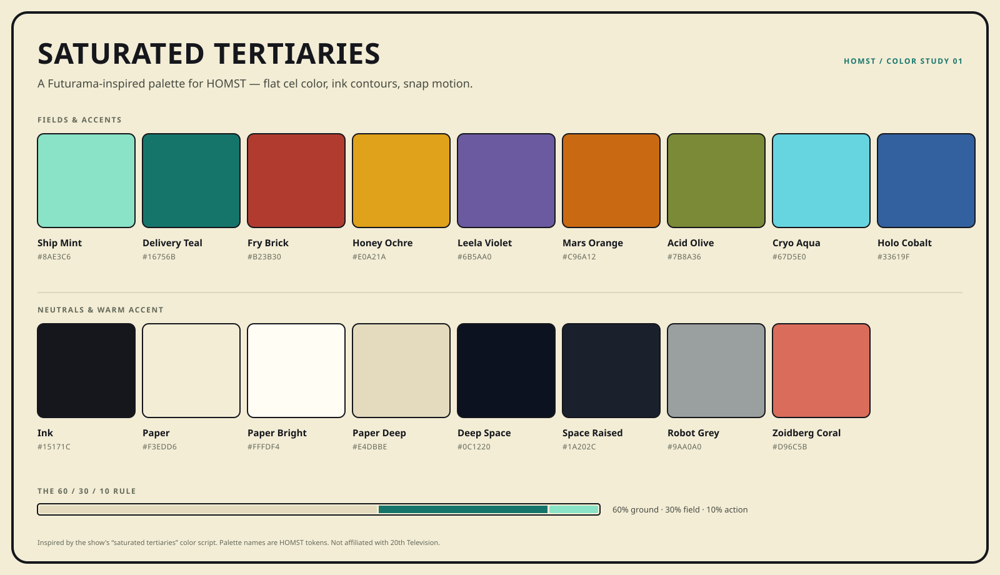

# Futurama Color & Motion Study

A design research note for HOMST. It documents the colors, color logic, and
animation grammar of *Futurama* (1999–), then derives a usable palette and a
set of rules for a wall-mounted household dashboard.

The short version: the show's signature is **saturated tertiaries** — olive,
ochre, rust, teal, taupe, and plum pushed to full strength — drawn as flat cel
fills inside hard ink contours. The palette is not a rainbow of primaries. It is
a color script where the "neutral" tertiary is the hero.

> "She called it 'saturated tertiaries,' meaning it's mostly not primary colors,
> like red, yellow, or blue. And it's not secondary colors, like green, orange,
> and purple. Tertiaries are this kind of gold or olive or taupe color … in
> *Futurama*, Samantha wants those to be the highlight colors, the main colors,
> so she saturates them."
>
> — Rich Moore, director, recalling color supervisor Samantha Harrison
> ([SlashFilm](https://www.slashfilm.com/1705582/futurama-animators-show-color-scheme-name))

---

## 1. Why the color scheme works

*Futurama* is drawn in flat shapes. There is almost no shading inside a shape,
no painterly texture, and no atmospheric gradient. A character's jacket is one
red; a planet's sky is one orange; a shadow is a second flat color. Separation
therefore has to come from three things:

1. **Hue** — adjacent shapes are pushed apart on the color wheel.
2. **Value** — ink outlines and dark shadow shapes keep silhouettes readable.
3. **Saturation** — the background is often as saturated as the foreground, so
   the characters never sit on a neutral gray stage.

This is the opposite of the usual animation rule that backgrounds should be
muted so characters pop. Harrison made the background a color event, then used
outlines and value contrast to keep the read clear. The show won an Emmy for
color styling for "A Bicyclops Built for Two" (2000), and the look is distinctive
enough that no other show shares it.

The practical lesson for an interface: **do not use color as decoration. Use it
as casting.** Each screen needs a dominant field, a counterpoint, and a neutral
that lets the eye rest.

---

## 2. Frame studies

Colors below were sampled from compressed publicity stills and episode frames
with a median-cut quantizer. They are approximations of the production color
keys, not official brand values. The point is the relationship between the
colors, not the exact pixel.

| Scene | Dominant field | Counterpoint | Ink / shadow | What it demonstrates |
|---|---|---|---|---|
| Crew in New New York (day) | `#79CDCD` sky, `#EEF6E1` cream | `#94484D` Fry's jacket, `#DFA98F` skin | `#373B29` olive-brown | A cool tertiary field with a brick counterpoint and cream breathing room |
| Alien mansion | `#715B32` olive/taupe, `#DCCCB3` marble | `#476EAE` cobalt sky, `#9C8BAB` lilac | `#0F1711` near-black green | Saturated tertiary architecture; complement used as sky and shadow, not as accent confetti |
| New New York at night | `#091121` navy, `#20484F` teal | `#2F7F71` statue green, `#E0A21A` window light | `#0D2829` deep teal | Dark scenes stay chromatic; warm light is the rarest and most valuable color |
| Planet Express ship | `#8AE3C6` mint hull, `#A3D7BA` pale mint | `#308E55` deep green stripe, `#7BBFB9` aqua | `#080918` city silhouette | One hero hue in many values; the ship reads by silhouette, not detail |
| Mars University | `#B86510` / `#C37612` orange sky | `#B4BB91` sage columns, `#4D4914` olive | `#372F1A` warm ink | A near-monochrome warm scene; tertiary olive does the work of a neutral |
| Robot Hell | `#843C08` rust, `#6D2B07` brick | `#99742B` ochre, a turquoise gear | `#261409` / `#0F0509` | Analogous heat palette with one cool counterpoint; menace without pure red |
| The Sting honey cave | `#F0B404` honey, `#935808` amber | Cyan hose, Fry's red suit | `#3C2108` dark brown | A monochrome field with two tiny complementary accents; color is the set |
| Omicron Persei 8 | `#000000` space | `#779454` acid green, `#556B39` olive | `#162218` dark green | Near-black plus one acid tertiary; no blue "space" cliché |
| VR internet (per the show) | Deep indigo | Neon green outlines | Indigo | Complementary outline system; color is the interface |

### Six consistent moves

1. **Tertiary fields, saturated.** Olive, ochre, rust, teal, taupe, and plum are
   used at full strength. Pure red, yellow, and blue are rare.
2. **Complementary counterpoint.** Red vs. green/teal (Fry vs. the ship), purple
   vs. gold (Leela vs. Mars), cyan vs. brick. The opposition is the composition.
3. **Flat fills.** Every shape is one color. Gradations are rare, and when they
   appear they are contained inside a single shape (honey, sky, a planet).
4. **Ink contours.** Black or near-black lines hold the shapes together and give
   the eye a place to land. Shadows are separate flat shapes, not blurs.
5. **Per-scene color scripts.** A scene commits to one field and one accent. The
   show does not average all its colors into every frame.
6. **Color is mood, not realism.** A planet can be acid green. A hell can be
   rust and ochre. A night city can be navy and emerald. The palette is cast to
   the story.

---

## 3. Animation grammar

*Futurama* is traditional 2D television animation — drawn poses, digital ink and
paint, limited animation — produced in the lineage of Rough Draft Studios. Its
motion is not smooth or continuous. It is **pose-to-pose**:

- **Snap.** A pose changes in one or two frames, then holds.
- **Hold.** The hold is where the joke lands. Motion is not filler.
- **Squash and stretch.** Bodies compress, stretch, and overshoot on impact.
- **Smears.** Fast actions get a distorted in-between drawing rather than a blur.
- **Hard cuts.** Scenes cut; they do not dissolve. Iris wipes and wipes are used
  as punctuation.
- **Camera moves over static art.** Pans and zooms create energy without
  redrawing every element.
- **Silhouette first.** Flat color means the outline has to carry the read.

The title sequence adds the other half of the identity: **Art Deco geometry**.
The titles use hand-lettering with ITC Kabel and Insignia, a callback to the
1939 New York World's Fair and Norman Bel Geddes's *Futurama* exhibit. The show's
future is retro-futurist: chunky hardware, CRT green, pneumatic tubes, Art Deco
curves, and 20th-century clutter rather than sleek chrome.

### What to borrow for a UI

- Snap, hold, overshoot, settle — not long ease-in-out fades.
- Hard cuts between views; one accent flash, then the new state.
- Squash-and-stretch on press; the control should feel like a drawn object.
- Strong silhouettes and large shapes; readable at a distance.
- Flat color fields instead of gradients and glass.
- Deco geometry in display type and a few structural curves, not in every card.

### What not to borrow

- 24 fps stutter or intentionally "limited" UI animation.
- Constant decorative motion. A wall display has to be calm at rest.
- Character art, logos, or catchphrases. The palette is inspiration, not a
  license.

---

## 4. The derived palette

The palette keeps the show's hue relationships but tunes each color for UI
contrast. It is organized as fields, inks, and accents.

### Core

| Token | Hex | Role | Notes |
|---|---|---|---|
| `paper` | `#F3EDD6` | Light ground | Warm cream, not gray; the "cel paper" |
| `paper-bright` | `#FFFDF4` | Cards / elevated | One step lighter than the ground |
| `paper-deep` | `#E4DBBE` | Subtle fills / dividers | Tinted neutral, never a gray |
| `ink` | `#15171C` | Outlines / body text | Near-black with a blue-violet cast |
| `deep-space` | `#0C1220` | Dark ground | Night sky navy, not pure black |
| `space-raised` | `#1A202C` | Dark surface | One step up from deep space |
| `robot-grey` | `#9AA0A0` | Metal / disabled | Bender gray; ink text passes 6.75:1 |

### Fields and accents

| Token | Hex | Role | Notes |
|---|---|---|---|
| `ship-mint` | `#8AE3C6` | Primary action fill | The Planet Express hull; ink text 11.85:1 |
| `delivery-teal` | `#16756B` | Primary text / active line | AA on paper (4.72:1) |
| `fry-brick` | `#B23B30` | Danger / urgent | Paper-bright text 5.79:1 |
| `honey-ochre` | `#E0A21A` | Warning / attention | Ink text 7.99:1; not body text on paper |
| `leela-violet` | `#6B5AA0` | Identity / info | AA on paper (4.98:1) |
| `mars-orange` | `#C96A12` | Warm field / weather | Ink text 4.74:1; paper text only at large sizes |
| `acid-olive` | `#7B8A36` | Success / growth | Ink text 4.72:1; pair with an icon |
| `zoidberg-coral` | `#D96C5B` | Warm secondary | Ink text 5.33:1 |
| `cryo-aqua` | `#67D5E0` | Cool highlight / live | Ink text 10.39:1 |
| `holo-cobalt` | `#33619F` | Info / links | AA on paper (5.34:1) |

### Character cues

The show's cast is a ready-made lesson in distinct color identities. These are
the cues worth carrying into member avatars — not the characters themselves.

| Cue | Palette | HOMST use |
|---|---|---|
| Fry | Fry Brick jacket, Holo Cobalt jeans, Paper tee | Brick + Cobalt + Paper |
| Leela | Leela Violet hair, Ship Mint eye, Ink outfit | Violet + Mint + Ink |
| Bender | Robot Grey shell, Honey Ochre eyes, Ink joints | Grey + Honey + Ink |
| Zoidberg | Zoidberg Coral shell, Paper Bright coat | Coral + Paper + Ink |
| Farnsworth | Paper coat, Delivery Teal glasses, Ink | Paper + Teal + Ink |
| Kif | Ship Mint skin, Acid Olive uniform | Mint + Olive |
| Amy | Zoidberg Coral top, Leela Violet trousers | Coral + Violet |
| Hermes | Acid Olive suit, Mars Orange accents | Olive + Orange |
| Nibbler | Mars Orange fur, Paper Deep diaper, Ink shadow | Orange + Paper Deep + Ink |

For HOMST member avatars, use the six most distinct cues. Keep Honey Ochre out
of identity colors so it stays reserved for warnings, and always pair the avatar
color with initials or a name, never color alone.

### Five-step ramps

| Family | 100 | 300 | 500 | 700 | 900 |
|---|---|---|---|---|---|
| Paper | `#FFFDF4` | `#F3EDD6` | `#E4DBBE` | `#C8BFA3` | `#8C8367` |
| Ink | `#3A3D46` | `#2A2D35` | `#15171C` | `#0C0E12` | `#000000` |
| Ship Mint | `#D6F8EC` | `#B5F3DF` | `#8AE3C6` | `#4FB99C` | `#16756B` |
| Fry Brick | `#F0B3A9` | `#D96C5B` | `#B23B30` | `#8E2A22` | `#6A1D17` |
| Honey | `#FCE3A0` | `#F2C64B` | `#E0A21A` | `#B27A0B` | `#8A6206` |
| Violet | `#CFC7E7` | `#A99BD2` | `#6B5AA0` | `#52447F` | `#3B305E` |
| Aqua | `#EDFCFD` | `#9AE7EF` | `#67D5E0` | `#2A9FAC` | `#17666F` |
| Olive | `#DADCAC` | `#A7C46A` | `#7B8A36` | `#5F6E2A` | `#46501D` |
| Space | `#3A4254` | `#1A202C` | `#0C1220` | `#070A10` | `#000000` |

### Scene keys

Use one key per screen, not all of them at once.

- **Delivery Day** (default light): paper ground, Delivery Teal structure, Ship
  Mint action, Honey Ochre for one alert. Calm, bright, legible.
- **Deep Space** (dark): deep-space ground, Ship Mint as the leading light,
  Cryo Aqua for live/sync, Leela Violet as the counterpoint. Glare-friendly.
- **Mars Campus** (warm light): paper tinted with honey, Mars Orange field,
  Acid Olive secondary, Ink structure. Afternoon light, no blue.
- **Robot Hell** (alert state only): Ink ground, Fry Brick field, Honey Ochre
  alert, no third chromatic family. Used for errors and urgent reminders, never
  as a theme.

**Usage ratio:** 60% ground (paper or deep space), 30% one tertiary field, 10%
action accent. If a screen needs a fourth chromatic family, the composition is
not finished.

---

## 5. Translating to HOMST

HOMST is a wall-mounted household dashboard: a calendar, a task board, today's
schedule, weather, photos, and reminders. It is used at a distance, in a shared
room, often in the morning. The existing system is already tactile and calm:
48 px touch targets, rubbery springs, soft clay lip shadows, and a muted accent
palette.

The Futurama direction keeps the tactility and changes the material:

| Keep | Change |
|---|---|
| 48 px touch targets and large type | Soft clay blur → hard ink lip shadows |
| Rubbery press/release springs | Gradient fills → flat cel fills |
| Calm at rest, alive on touch | Muted sage/peach → saturated tertiaries |
| 8 px spacing grid and pill controls | Figtree-only → Jost display + Figtree body |
| Wall-first density | Decorative gradients → ink contours and flat fields |

What not to do: do not put Fry, Bender, the Planet Express ship, or the logo on
the dashboard. Do not use catchphrases. Do not turn the UI into a cartoon
costume. The show is a **color and motion logic**, not an asset pack.

The implementation lives in `web/public/futur.css` and
`web/src/composables/useSettings.ts`. The palette above is the design record.

---

## 6. Sources and method

- Witney Seibold, "Futurama Animators Have A Specific Name For The Show's
  Unique Color Scheme," *SlashFilm*, Nov. 12, 2024. Includes Rich Moore and
  Samantha Harrison quotes and frames from "A Bicyclops Built for Two" and
  "The Sting." <https://www.slashfilm.com/1705582/futurama-animators-show-color-scheme-name>
- *The Art of Futurama* (Abrams, 2024), as quoted in the SlashFilm article.
- Stephen Coles, "Futurama opening title sequence," *Fonts in Use*, Jan. 1,
  2014. ITC Kabel, Insignia, Art Deco, 1939 New York World's Fair.
  <https://fontsinuse.com/uses/5567/futurama-opening-title-sequence>
- Motivarti, "Samantha Harrison Recap," July 14, 2010. Rough Draft Studios and
  television color supervision. <https://motivarti.wordpress.com/2010/07/14/samantha-harrison-recap>
- Frame samples: *Futurama* Fandom stills (New New York, Planet Express ship,
  Robot Hell, Mars University, Omicron Persei 8, The Sting) and SlashFilm
  publicity frames (crew, alien mansion). Sampled with Python/Pillow median-cut
  quantization; values are approximations.
- Contrast ratios calculated with the WCAG 2.x relative-luminance formula.

*Futurama* is © 20th Television. This is an unaffiliated design study; no show
artwork, logos, or characters are included in the palette or the HOMST design.
